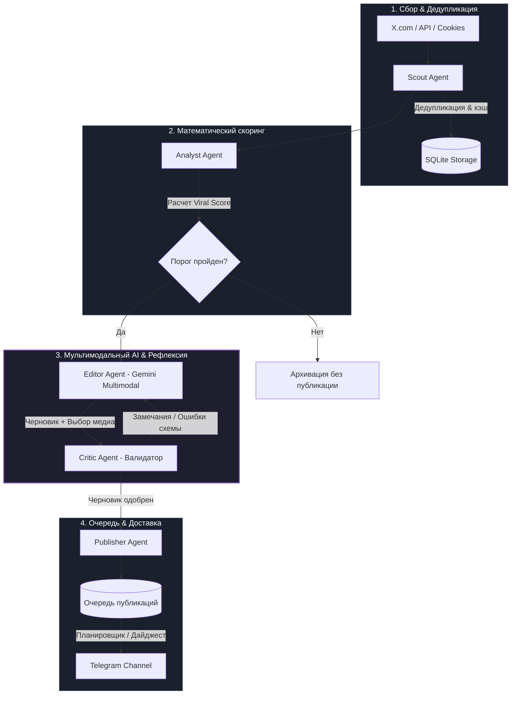

# 🚀 Universal Viral Hunter

<div align="center">

[](https://github.com/aqwarius2003/universal-viral-hunter/actions/workflows/ci.yml)
[](https://www.python.org/downloads/)
[](https://github.com/langchain-ai/langgraph)
[](https://ai.google.dev/)
[](https://www.docker.com/)
[](tests/)
[](LICENSE)

**Автономный мультиагентный пайплайн для мониторинга трендов, мультимодального анализа контента и интеллектуальной публикации в Telegram.**

[Архитектура](#-архитектура-пайплайна) •
[Ключевые инженерные решения](#-ключевые-инженерные-решения) •
[Быстрый старт](#-быстрый-старт) •
[Веб-панель](#-веб-панель-управления) •
[Тестирование](#-тестирование-и-качество-кода)

</div>

---

## 📌 О проекте

**Universal Viral Hunter** — это отказоустойчивая асинхронная система для автоматизированного поиска виральных постов, глубокой AI-фильтрации, суммаризации и регулярной публикации экспертного контента.

Архитектура построена по принципу разделения ответственности: источник данных (X.com / Twitter), скоринговая аналитика, мультимодальная нейросетевая обработка, контроль качества и каналы доставки (Telegram) полностью изолированы друг от друга и управляются единым графом состояний **LangGraph**.

---

## 🏗 Архитектура пайплайна

Основной конвейер обработки спроектирован как конечный автомат с агентным циклом рефлексии (**Reflection Loop**):



### Роли агентов в графе:
* **`Scout Agent`**: Асинхронный сбор свежих публикаций по настраиваемым топикам, обработка поисковых режимов (`Latest`, `Top`, `Both`), автоматический refresh сессионных токенов и дедупликация в базе.
* **`Analyst Agent`**: Детерминированный математический расчет виральности на основе скорости набора реакций, отношения репостов к лайкам, закладок и возраста публикации.
* **`Editor Agent`**: Мультимодальный AI-узел на базе Google Gemini. Анализирует прикрепленные изображения (выбирает графики, архитектурные схемы или инфографику), переводит и формирует структурированный пост со строгой Pydantic JSON-схемой.
* **`Critic Agent`**: Агент контроля качества и бизнес-правил. Проверяет соблюдение ограничений на длину заголовков, формат тезисов и наличие хэштегов. При ошибках возвращает черновик на повторную генерацию в цикле рефлексии.
* **`Publisher Agent`**: Управление очередью, соблюдение лимитов Telegram API, автопубликация с учетом «тихих часов» и формирование суточных дайджестов.

---

## ⚡ Ключевые инженерные решения

* **LangGraph State Machine с рефлексией:** Контролируемый агентский цикл исключает галлюцинации и гарантирует соблюдение редакционной политики канала.
* **Dual-Model Fallback (Fault Tolerance):** Интеллектуальный роутер запросов с автоматическим переключением моделей (Primary $\to$ Fallback) при возникновении лимитов `429 Too Many Requests` или сбоев `503 Service Unavailable`.
* **Rate Limiter & Token Economy:** Встроенный адаптивный ограничитель RPM/TPM предотвращает превышение квот Google Gemini API.
* **Мультимодальное зрение:** Интеллектуальный выбор наиболее информативного изображения среди вложений к твиту для максимизации вовлеченности в Telegram.
* **Dual Safeguards конфигурации:** Двусторонняя синхронизация системных настроек между SQLite и `.env` с автоматическим созданием бэкапов (`.env.bak`) и строгой защитой от перезаписи маскированных секретов.
* **RBAC & Безопасность:** Двухуровневая модель доступа (`admin` и `editor`), хэширование паролей через PBKDF2-HMAC-SHA256, подпись сессий через HMAC-SHA256 и встроенная защита от брутфорса с временной блокировкой IP.

---

## 💻 Стек технологий

| Категория | Технологии |
|---|---|
| **Язык & Рантайм** | Python 3.11 – 3.13 |
| **Менеджер пакетов** | [Poetry](https://python-poetry.org/) 2.x |
| **Агентский оркестратор** | [LangGraph](https://github.com/langchain-ai/langgraph), [LangChain Core](https://github.com/langchain-ai/langchain) |
| **Нейросетевые модели** | Google Gemini (gemini-2.5-flash, gemini-3.5-flash-lite, multimodal vision) |
| **Хранилище данных** | SQLite3 + [aiosqlite](https://github.com/omnilib/aiosqlite) (полностью асинхронный драйвер) |
| **Веб-сервер & API** | [aiohttp](https://github.com/aio-libs/aiohttp) |
| **Интеграции** | [aiogram 3.x](https://github.com/aiogram/aiogram), [twifork](https://github.com/twifork/twifork), Playwright |
| **Инфраструктура** | Docker, Docker Compose, GitHub Actions CI/CD |
| **Тестирование** | pytest, pytest-asyncio, pytest-mock |

---

## 🚀 Быстрый старт

### Требования
* Python 3.11+
* Poetry 2.x (или Docker & Docker Compose)
* API-ключ Google Gemini ([получить бесплатно в Google AI Studio](https://aistudio.google.com/))
* Токен Telegram-бота с правами администратора в вашем канале

### Вариант 1: Запуск через Docker Compose (Рекомендуется)

```bash
# 1. Клонирование репозитория
git clone https://github.com/aqwarius2003/universal-viral-hunter.git
cd universal-viral-hunter

# 2. Создание файла переменных окружения
cp .env.example .env

# 3. Запуск контейнеров
docker compose up -d --build
```
Веб-интерфейс будет доступен по адресу: `http://localhost:8000`.

---

### Вариант 2: Локальная разработка

```bash
# 1. Установка зависимостей через Poetry
poetry install

# 2. Настройка конфигурации
cp .env.example .env
# Заполните AI_API_KEY и параметры Telegram в .env

# 3. Запуск планировщика и веб-сервера
poetry run python -m src.scheduler
```

Полезные флаги запуска:
```bash
# Запуск без немедленного сбора при старте
poetry run python -m src.scheduler --skip-initial

# Изменение интервала сбора
poetry run python -m src.scheduler --minutes 30

# Ручная генерация дайджеста
poetry run python -m src.scheduler --digest-now
```

---

## 🖥 Веб-панель управления

Система оснащена встроенным асинхронным веб-дашбордом:
* **Мониторинг здоровья компонентов:** статус подключения к Gemini API, доступность X.com, валидность токена Telegram-бота и прав в канале.
* **Интерактивная очередь публикаций:** просмотр отобранных постов, ручное редактирование AI-текста, изменение порядка отправки и планирование точного времени.
* **Управление топиками и промптами:** гибкая настройка поисковых запросов и системных инструкций для нейросети прямо из браузера.
* **Дайджесты:** конфигурация утренних и вечерних подборок новостей с настраиваемыми часовыми поясами.

---

## 🧪 Тестирование и качество кода

Проект спроектирован с высоким уровнем покрытия автоматическими тестами. Тестовый набор изолирует базу данных и переменные окружения каждого теста в `tmp_path`, исключая сайд-эффекты.

Запуск тестового набора:
```bash
poetry run pytest
```

Результат:
```text
===================== 155 passed, 0 failed in 28.86s =====================
```

Тесты проверяют:
* Роутинг и фоллбек мультимодальных моделей при `429 Too Many Requests`.
* Валидацию схем Pydantic и цикл рефлексии Critic $\to$ Editor.
* Формулу виральности и дедупликацию постов в базе данных.
* RBAC-авторизацию, токены сессий и устойчивость веб-эндпоинтов к сбоям.
* Формирование суточных дайджестов и расписание тихих часов.

---

## 📁 Структура репозитория

```text
universal-viral-hunter/
├── .github/workflows/       # GitHub Actions CI пайплайн
├── src/
│   ├── ai/
│   │   ├── agents/          # Агенты LangGraph (Scout, Analyst, Editor, Critic, Publisher)
│   │   ├── rate_limiter.py  # Управление лимитами RPM / TPM
│   │   └── schema.py        # Pydantic-схемы валидации данных
│   ├── analytics/           # Анализ вовлеченности и расчет Viral Score
│   ├── telegram/            # Модули отправки и форматирования постов
│   ├── utils/               # Менеджер медиа, аудит безопасности и хэштеги
│   ├── web/                 # Веб-панель управления (aiohttp + HTML5/CSS)
│   ├── config.py            # Pydantic Settings конфигурация
│   ├── db.py                # Асинхронный слой базы данных (aiosqlite)
│   ├── digest.py            # Логика формирования суточных дайджестов
│   └── scheduler.py         # Планировщик задач и точка входа
├── tests/                   # Набор из 155 модульных и интеграционных тестов
├── docker-compose.yml       # Конфигурация запуска Docker
├── Dockerfile               # Оптимизированный мультистейдж Dockerfile
├── pyproject.toml           # Зависимости и конфигурация Poetry
└── README.md                # Документация проекта
```

---

## 📄 Лицензия

Проект распространяется под открытой лицензией [MIT](LICENSE).
