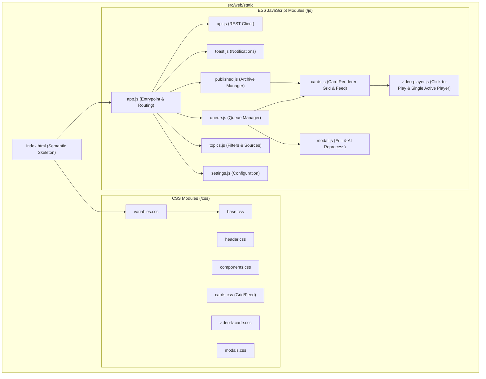

# Frontend Modernization & Video Redesign Implementation Plan

> **For agentic workers:** REQUIRED SUB-SKILL: Use superpowers:subagent-driven-development to implement this plan task-by-task. Steps use checkbox (`- [ ]`) syntax for tracking.

**Goal:** Modularize the monolithic 6358-line `index.html` into clean ES6+ modules and modular CSS, implement a zero-preload Click-to-Play video facade, a compact 2-row header, and a dual-view switcher (Media Grid with hover text overlay vs Editorial Feed).

**Architecture:** Decompose the frontend into semantic CSS stylesheets and native ES6 JavaScript modules loaded without any build step by modern browsers. Replace eager `<video>` DOM nodes with lightweight `
` containers using lazy-loaded poster thumbnails and interactive play triggers.

**Architecture Diagram:**

**Tech Stack:** HTML5, Modern CSS3 (Grid/Flexbox/CSS Variables/Glassmorphism), Vanilla ES6+ Modules (`<script type="module">`). 100% Docker-compatible without Node.js.

**Spec:** `docs/superpowers/specs/2026-10-17-frontend-modernization-design.md`

## Global Constraints

- Zero changes to Python server routes (`/static` and `/` remain the exact endpoints).
- Zero Node.js or npm dependencies introduced to Docker or repository.
- No eager video buffering: 0 bytes of video streamed until user clicks.
- Backup existing `index.html` safely as `index.legacy.html` before replacement.

---

### Task 1: Scaffolding and Legacy Backup

**Files:**
- Create: `src/web/static/index.legacy.html` (copy of existing `src/web/static/index.html`)
- Create: directories `src/web/static/css` and `src/web/static/js`
- Test: verify file copy and directory presence

**Interfaces:**
- Consumes: `src/web/static/index.html`
- Produces: safe backup `index.legacy.html`

- [ ] **Step 1: Backup `index.html` to `index.legacy.html`**
- [ ] **Step 2: Create `css/` and `js/` directories**
- [ ] **Step 3: Commit backup**

---

### Task 2: Modular CSS Architecture

**Files:**
- Create: `src/web/static/css/variables.css` (Dark Telegram color tokens, typography, shadows)
- Create: `src/web/static/css/base.css` (reset, layout containers, typography)
- Create: `src/web/static/css/header.css` (compact 2-row header: row 1 status+actions 44px, row 2 tabs+view switcher 38px)
- Create: `src/web/static/css/components.css` (buttons, badges, inputs, toasts, tables, status dots)
- Create: `src/web/static/css/video-facade.css` (video preview, frosted glass Play button, duration/quality badges, active player container)
- Create: `src/web/static/css/cards.css` (grid layout, media-first card, hover text overlay, editorial feed layout)
- Create: `src/web/static/css/modals.css` (edit post modal, char counter, AI instruction box, image selection)

**Interfaces:**
- Consumes: CSS tokens from legacy index.html
- Produces: Clean modular stylesheets linked in HTML `<head>`

- [ ] **Step 1: Extract and write `variables.css` and `base.css`**
- [ ] **Step 2: Write `header.css` with the compact 2-row design**
- [ ] **Step 3: Write `video-facade.css` with the frosted-glass play button and transitions**
- [ ] **Step 4: Write `cards.css` supporting `.mode-grid` (with hover overlay) and `.mode-feed`**
- [ ] **Step 5: Write `components.css` and `modals.css`**
- [ ] **Step 6: Commit CSS modules**

---

### Task 3: Core Utilities & API Client (`toast.js`, `api.js`)

**Files:**
- Create: `src/web/static/js/toast.js`
- Create: `src/web/static/js/api.js`

**Interfaces:**
- Consumes: REST endpoints `/api/queue`, `/api/published`, `/api/settings`, `/api/topics`, `/api/scout/trigger`
- Produces:
  - `showToast(msg, type)`
  - `api.get(url)`, `api.post(url, data)`, `api.put(url, data)`, `api.delete(url)`

- [ ] **Step 1: Implement `toast.js` with auto-dismiss and color types (success, error, warning, info)**
- [ ] **Step 2: Implement `api.js` with structured error handling and JSON parsing**
- [ ] **Step 3: Commit core utilities**

---

### Task 4: Video Player Module (`video-player.js`)

**Files:**
- Create: `src/web/static/js/video-player.js`

**Interfaces:**
- Consumes: Facade DOM node, video URLs, thumbnail URLs
- Produces:
  - `renderVideoFacade(videoData, fallbackImage, options)` -> HTML string
  - `activateVideoPlayer(facadeElement, videoSrc)`
  - `setupVideoObserver()` (auto-pause on scroll)
  - `stopActiveVideo()`

- [ ] **Step 1: Implement `renderVideoFacade` producing lightweight HTML without `<video>` or `<source>`**
- [ ] **Step 2: Implement `activateVideoPlayer` with single-player policy and autoplay**
- [ ] **Step 3: Implement `IntersectionObserver` to pause video if scrolled off-screen**
- [ ] **Step 4: Commit `video-player.js`**

---

### Task 5: Cards Renderer & Post Views (`cards.js`, `queue.js`, `published.js`)

**Files:**
- Create: `src/web/static/js/cards.js`
- Create: `src/web/static/js/queue.js`
- Create: `src/web/static/js/published.js`

**Interfaces:**
- Consumes: Post objects from API, `video-player.js`
- Produces:
  - `renderPostCard(post, index, viewMode, isArchive)`
  - `loadQueue()`, `movePost(id, direction)`, `publishPost(id)`, `deletePost(id)`
  - `loadPublished()`

- [ ] **Step 1: Implement unified `renderPostCard` supporting both Grid (hover overlay) and Feed views**
- [ ] **Step 2: Implement `queue.js` with optimistic UI updates and backend synchronization**
- [ ] **Step 3: Implement `published.js` for post archive rendering**
- [ ] **Step 4: Commit cards and queue modules**

---

### Task 6: Modals, Topics & Settings (`modal.js`, `topics.js`, `settings.js`)

**Files:**
- Create: `src/web/static/js/modal.js`
- Create: `src/web/static/js/topics.js`
- Create: `src/web/static/js/settings.js`

**Interfaces:**
- Consumes: `api.js`, `toast.js`
- Produces:
  - `openEditModal(tweetId)`, `saveEditModal()`, `reprocessPostWithAI()`
  - `loadTopics()`, `createTopic()`, `deleteTopic()`
  - `loadSettings()`, `saveSettings()`

- [ ] **Step 1: Implement `modal.js` with live character limit audit (1024 / 4096) and AI reprocess**
- [ ] **Step 2: Implement `topics.js` for topic management**
- [ ] **Step 3: Implement `settings.js` for system settings, scheduler & video options**
- [ ] **Step 4: Commit modal, topics and settings modules**

---

### Task 7: Entrypoint & Modern HTML Skeleton (`app.js`, `index.html`)

**Files:**
- Create: `src/web/static/js/app.js`
- Overwrite: `src/web/static/index.html` (clean skeleton, ~250-300 lines)

**Interfaces:**
- Consumes: All CSS modules, all JS modules
- Produces: The primary SPA interface loaded at `/`

- [ ] **Step 1: Implement `app.js` (tab switching, clock, status poller, view switcher state)**
- [ ] **Step 2: Write semantic, compact `index.html` referencing `<script type="module" src="/static/js/app.js">`**
- [ ] **Step 3: Commit application entrypoint**

---

### Task 8: Verification & Smoke Testing

**Files:**
- Verify: `src/web/server.py` serving static files
- Verify: browser HTTP response codes, asset loading, network requests
- Verify: video click-to-play, view switcher, queue actions

- [ ] **Step 1: Run Python web server tests or launch local server check**
- [ ] **Step 2: Inspect network response for `/static/css/*` and `/static/js/*`**
- [ ] **Step 3: Verify zero video buffering on initial page load**
- [ ] **Step 4: Verify click-to-play, hover text overlay, and modal editing**
- [ ] **Step 5: Final commit & documentation update**
