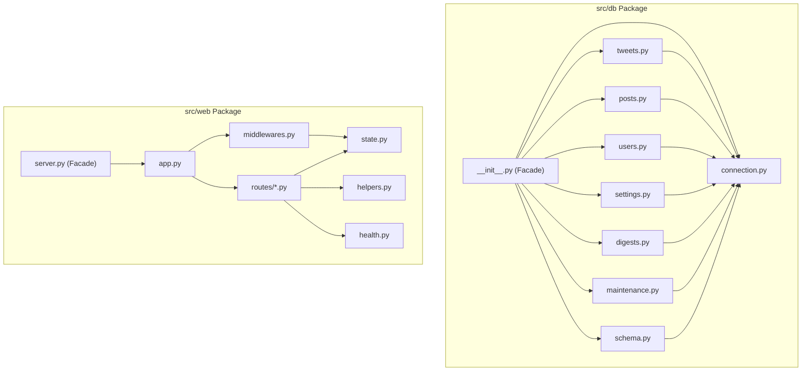

# Modular Refactoring Implementation Plan

> **For agentic workers:** REQUIRED SUB-SKILL: Use superpowers:subagent-driven-development to implement this plan task-by-task. Steps use checkbox (`- [ ]`) syntax for tracking.

**Goal:** Refactor monolithic files `src/db.py` (1720 lines) and `src/web/server.py` (2309 lines) into clean, modular, single-responsibility submodules with 100% backward-compatible facades, ensuring all 179 tests pass.

**Architecture:** Decompose `src/db.py` into a `src/db/` package with domain-focused modules (`connection`, `schema`, `tweets`, `posts`, `users`, `settings`, `digests`, `maintenance`) and an `__init__.py` facade re-exporting all symbols. Decompose `src/web/server.py` into `state`, `middlewares`, `helpers`, `health`, `routes/`, `app`, leaving a minimal `src/web/server.py` re-export facade.

**Architecture Diagram:**

**Tech Stack:** Python 3.11+, aiohttp, aiosqlite, pytest.

**Spec:** [docs/superpowers/specs/2026-10-19-modular-refactoring-design.md](file:///D:/universal-viral-hunter/docs/superpowers/specs/2026-10-19-modular-refactoring-design.md)

## Global Constraints
- Preserve 100% backward compatibility for all existing public functions, classes, and constants.
- Do not alter runtime behavior, database schema, or API contracts.
- All 179 existing pytest tests must pass on every commit.
- Keep module sizes under ~300-400 lines where possible.

---

### Task 1: Initialize `src/db/` package structure and extract connection & schema

**Files:**
- Create: `src/db/__init__.py` (transition from `src/db.py`)
- Create: `src/db/connection.py`
- Create: `src/db/schema.py`
- Delete: `src/db.py`
- Test: `tests/test_db_extensions.py`

**Interfaces:**
- Consumes: `aiosqlite`, `src.config.settings`
- Produces: `get_db_connection()`, `_deserialize_row()`, `normalize_to_utc_iso()`, `init_db()`

- [ ] **Step 1: Convert `src/db.py` into `src/db/__init__.py`**
  Move `src/db.py` to `src/db/__init__.py` and remove `src/db.py`.
- [ ] **Step 2: Run pytest to verify package resolution**
  Run: `.\.venv\Scripts\pytest tests/test_db_extensions.py`
  Expected: PASS
- [ ] **Step 3: Extract `connection.py` and `schema.py`**
  Move connection helpers and DDL initialization/migrations into `src/db/connection.py` and `src/db/schema.py`. Import and re-export them in `src/db/__init__.py`.
- [ ] **Step 4: Run pytest to verify connection and schema extraction**
  Run: `.\.venv\Scripts\pytest tests/test_db_extensions.py`
  Expected: PASS
- [ ] **Step 5: Commit**
  Run: `git add src/db/ && git commit -m "refactor(db): create src/db package with connection and schema"`

---

### Task 2: Extract `tweets.py`, `posts.py`, and `users.py` into `src/db/`

**Files:**
- Create: `src/db/tweets.py`
- Create: `src/db/posts.py`
- Create: `src/db/users.py`
- Modify: `src/db/__init__.py`
- Test: `tests/test_db_extensions.py`, `tests/test_auth_and_security.py`

**Interfaces:**
- Consumes: `src.db.connection`
- Produces:
  - `tweets.py`: `save_raw_tweets`, `get_tweet_by_id`, `filter_new_tweets`, `update_tweet_status_and_score`, `update_tweet_metrics`, `set_tweet_status`, `find_duplicate_video_in_db`, `get_tweets_last_24h`, `get_recent_active_tweets`, `get_filtered_tweets`
  - `posts.py`: `get_queued_posts`, `get_published_posts`, `get_unposted_tweets`, `auto_schedule_queue`, `reorder_queue`, `update_post_schedule`, `cancel_scheduled_post`, `mark_post_published`, `update_post_content`, `save_tweet_admin_message_id`, `get_tweet_admin_message_id`
  - `users.py`: `create_user`, `authenticate_user`, `get_user_by_username`, `get_all_users`, `update_user_password`, `delete_user`, `get_user_count`

- [ ] **Step 1: Extract `tweets.py`, `posts.py`, `users.py` from `src/db/__init__.py`**
- [ ] **Step 2: Re-export extracted functions in `src/db/__init__.py`**
- [ ] **Step 3: Run pytest on affected tests**
  Run: `.\.venv\Scripts\pytest tests/test_db_extensions.py tests/test_auth_and_security.py`
  Expected: PASS
- [ ] **Step 4: Commit**
  Run: `git add src/db/ && git commit -m "refactor(db): extract tweets, posts, and users modules"`

---

### Task 3: Extract `settings.py`, `digests.py`, `maintenance.py` and finalize `src/db/__init__.py`

**Files:**
- Create: `src/db/settings.py`
- Create: `src/db/digests.py`
- Create: `src/db/maintenance.py`
- Modify: `src/db/__init__.py`
- Test: `tests/test_reset_content.py`, `tests/test_digest_schedules.py`, `tests/test_digest.py`

**Interfaces:**
- Consumes: `src.db.connection`
- Produces:
  - `settings.py`: `save_system_settings_dual`, `load_system_settings_into_config`, `is_secret_placeholder_or_empty`, `get_topics`, `get_active_topics`, `create_topic`, `update_topic`, `delete_topic`
  - `digests.py`: `get_digest_schedules`, `save_digest_schedule`, `delete_digest_schedule`, `mark_digest_schedule_run`, `get_digest_schedules_due`, `get_due_scheduled_digests`, `create_digest_draft`, `publish_digest`, `get_digests_list`, `get_staging_tweets`, `mark_digest_posted`, `is_digest_posted`
  - `maintenance.py`: `record_pipeline_run`, `get_recent_pipeline_runs`, `export_tweets_data_stream`, `delete_historical_data`, `cleanup_expired_posts`, `clear_all_content_data`

- [ ] **Step 1: Extract `settings.py`, `digests.py`, and `maintenance.py`**
- [ ] **Step 2: Clean `src/db/__init__.py` to be pure re-export facade with `__all__`**
- [ ] **Step 3: Run full test suite for DB phase**
  Run: `.\.venv\Scripts\pytest`
  Expected: 179 passed
- [ ] **Step 4: Commit**
  Run: `git add src/db/ && git commit -m "refactor(db): finalize src/db package modularization"`

---

### Task 4: Extract `src/web/state.py`, `middlewares.py`, `helpers.py`, `health.py`

**Files:**
- Create: `src/web/state.py`
- Create: `src/web/middlewares.py`
- Create: `src/web/helpers.py`
- Create: `src/web/health.py`
- Modify: `src/web/server.py`
- Test: `tests/test_monitoring.py`

**Interfaces:**
- Produces:
  - `state.py`: `pipeline_lock`, `pipeline_runtime`, `login_limiter`, `STATIC_DIR`, `get_client_ip`
  - `middlewares.py`: `auth_middleware`
  - `helpers.py`: `_generate_summary_for_tweet`, `_ensure_russian_summaries`, `_safe_run_pipeline`
  - `health.py`: `check_twitter_health`, `check_gemini_health`, `check_telegram_health`

- [ ] **Step 1: Create `state.py`, `middlewares.py`, `helpers.py`, `health.py`**
- [ ] **Step 2: Import them into `src/web/server.py`**
- [ ] **Step 3: Run monitoring and auth tests**
  Run: `.\.venv\Scripts\pytest tests/test_monitoring.py tests/test_auth_and_security.py`
  Expected: PASS
- [ ] **Step 4: Commit**
  Run: `git add src/web/ && git commit -m "refactor(web): extract state, middlewares, helpers and health checks"`

---

### Task 5: Extract modular route handlers into `src/web/routes/`

**Files:**
- Create: `src/web/routes/__init__.py`
- Create: `src/web/routes/auth.py`
- Create: `src/web/routes/posts.py`
- Create: `src/web/routes/settings.py`
- Create: `src/web/routes/pipeline.py`
- Create: `src/web/routes/digests.py`
- Create: `src/web/routes/twitter.py`
- Create: `src/web/routes/system.py`
- Modify: `src/web/server.py`
- Test: `tests/test_web_api.py`, `tests/test_auth_and_security.py`

**Interfaces:**
- Produces:
  - Route handlers for all HTTP endpoints.

- [ ] **Step 1: Create `src/web/routes/auth.py`, `posts.py`, `settings.py`, `pipeline.py`, `digests.py`, `twitter.py`, `system.py`**
- [ ] **Step 2: Re-export all handlers in `src/web/server.py`**
- [ ] **Step 3: Run API tests**
  Run: `.\.venv\Scripts\pytest tests/test_web_api.py`
  Expected: PASS
- [ ] **Step 4: Commit**
  Run: `git add src/web/routes/ src/web/server.py && git commit -m "refactor(web): extract modular route handlers"`

---

### Task 6: Create `src/web/app.py` and convert `src/web/server.py` to a facade

**Files:**
- Create: `src/web/app.py`
- Modify: `src/web/server.py`
- Test: `tests/test_web_api.py`, `tests/test_frontend_static.py`

**Interfaces:**
- Produces:
  - `app.py`: `create_app()`, `on_app_startup()`, `setup_routes()`, `start_web_server()`
  - `server.py`: re-export facade of `create_app`, `start_web_server`, and route handlers

- [ ] **Step 1: Implement `create_app` and `setup_routes` in `src/web/app.py`**
- [ ] **Step 2: Simplify `src/web/server.py` to re-export `create_app`, `start_web_server` and handlers**
- [ ] **Step 3: Run full web test suite**
  Run: `.\.venv\Scripts\pytest tests/test_web_api.py tests/test_frontend_static.py tests/test_monitoring.py`
  Expected: PASS
- [ ] **Step 4: Commit**
  Run: `git add src/web/app.py src/web/server.py && git commit -m "refactor(web): modularize app creation and simplify server facade"`

---

### Task 7: Full verification and cleanup

**Files:**
- Verify: all project files
- Test: entire test suite (179 tests)

- [ ] **Step 1: Run full pytest suite**
  Run: `.\.venv\Scripts\pytest`
  Expected: 179 passed
- [ ] **Step 2: Check line counts of new files to verify clean decomposition**
  Run: verify all modules are under ~400 lines
- [ ] **Step 3: Final commit and summary**
